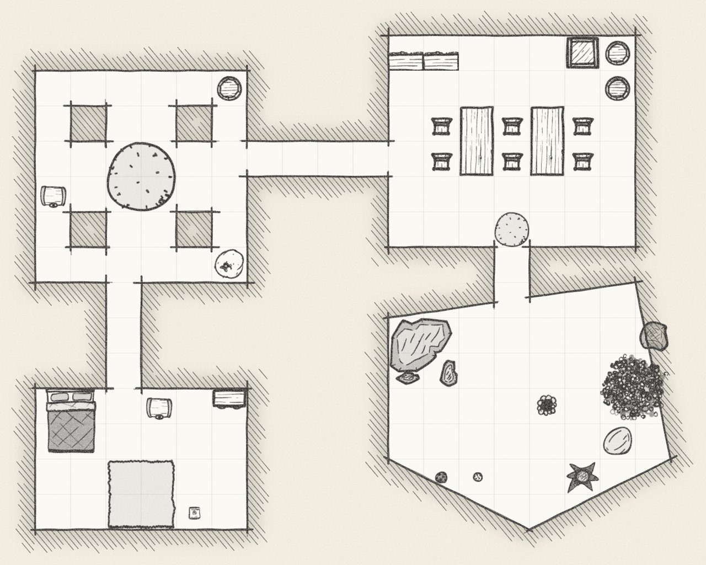
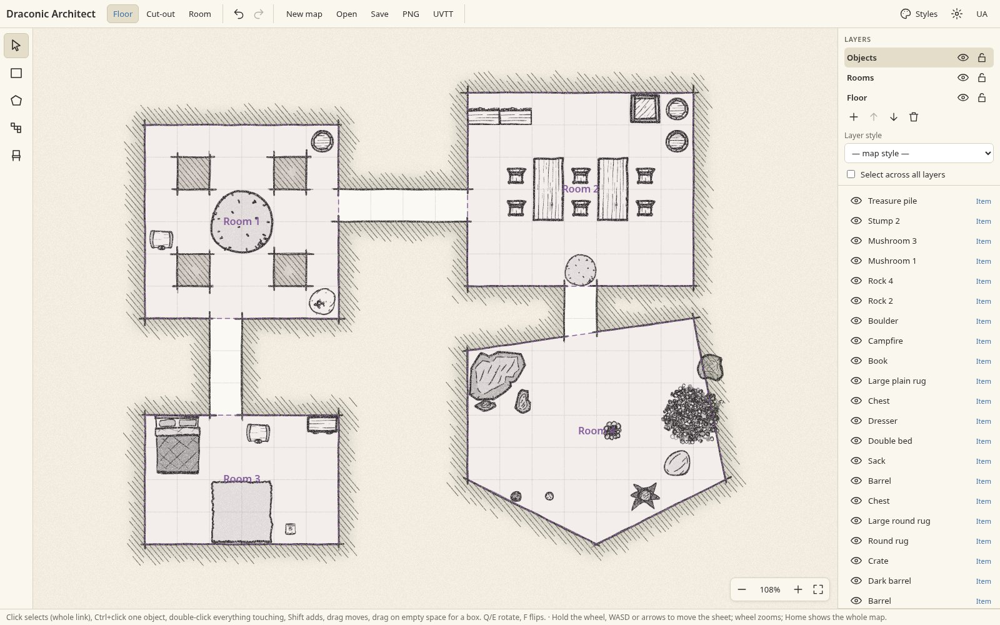
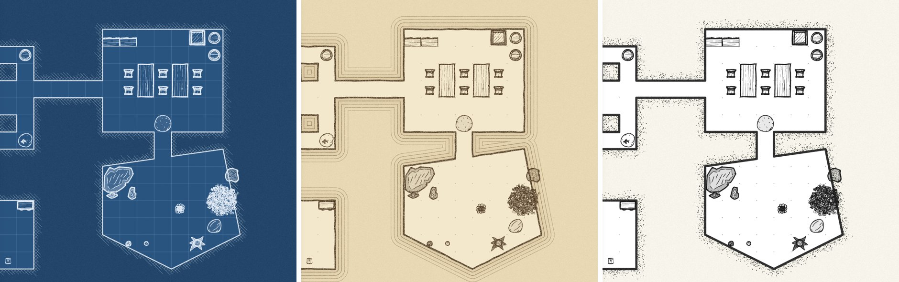

# Draconic Architect



Pencil-on-paper dungeon maps for tabletop RPGs. Draw rooms and corridors, furnish them, pick a look,
then send the map to an [Owlbear Rodeo](https://www.owlbear.rodeo) table with walls for dynamic fog,
or export it as PNG or UVTT.

**[Open the editor](https://gammercvest.github.io/draconic-architect/)** · [Українською](README.uk.md)

## Features

- Floors from rectangles, polygons or a cell brush; cut out pillars and alcoves; outline and name rooms.
- Several looks: pencil sketch, ink and stipple, blueprint, parchment with contour lines and more.
  Mix styles in one map or make your own with paper and floor textures and stamped marks.
- Over 280 top-down furniture pieces and props, redrawn in the ink of your map's style.
- Layers, stacking priority, linked groups, attaching one object to another, merging shapes.
- Export to PNG, or to UVTT (`.dd2vtt`) for Smoke & Spectre, Foundry and other virtual tabletops.
- Ukrainian and English interface.





## Install in Owlbear Rodeo

Add the extension with this link (see the [extension guide](https://extensions.owlbear.rodeo/guide) for how):

```
https://gammercvest.github.io/draconic-architect/manifest.json
```

In a room, open Draconic Architect from the extensions menu, draw your map and press **To table**.
It creates a new scene with the map as the background and walls along every room outline.

## Development

```sh
npm install
npm run dev      # http://localhost:5173
npm run lint     # type check and formatting
npm run build    # static site in dist/
```

Pushes to `main` publish the site to GitHub Pages.

## License

Code: [GPL-3.0-or-later](LICENSE).
Furniture and map symbols: Mark Gosbell, CC0 — see [credits](public/assets/items/CREDITS.md).
